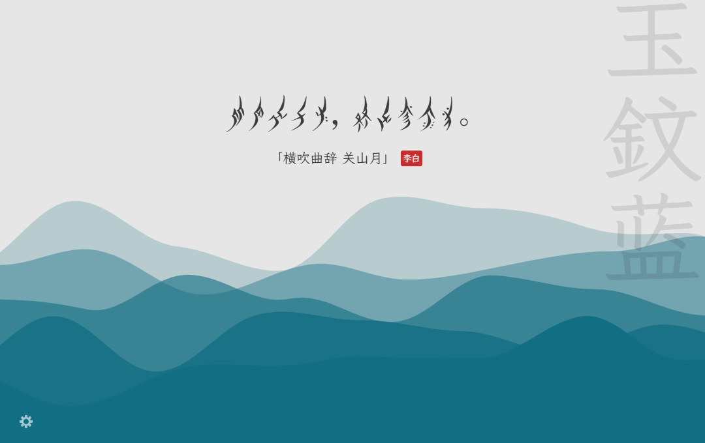

# 几枝·增强版 | Jizhi Enhanced（非官方）

[](#contributors)

几枝·增强版是一款古诗词新标签页扩展。每次打开新标签页，都可以欣赏一联诗词与传统色波浪，也能固定喜欢的诗句、选用女书凤栖或自定义配色。

## 下载与安装

**增强版下载入口**见 [GitHub Releases](https://github.com/Amy22707/jizhi/releases)。如发布页已提供 `chrome.zip`，下载并解压即可。手上已有源码时，也可以按下面的步骤生成安装包。

1. 打开 Chrome 的扩展程序页面 `chrome://extensions/`，开启「开发者模式」。
2. 点击「加载已解压的扩展程序」，选择含 `manifest.json` 的解压目录。从源码打包时，选择 `builds/build_chrome`。
3. 打开一个新标签页即可体验。更新时，在扩展卡片上点击「重新加载」。

### 从源码打包

在项目目录执行以下命令。

```sh
npm install --legacy-peer-deps
npm run build
```

构建后，`builds/build_chrome` 是可直接加载的目录，`builds/chrome.zip` 是可解压安装的压缩包。

## 功能

- 打开新标签页，欣赏中国传统色的层叠波浪或 Blobs 动画。保留浅色、深色和跟随系统、动静切换、横排与竖排、色名淡出、可选搜索框和背景截图。空格暂停或播放，波浪背景下左右键换色，Alt+S 保存背景。
- 8,500 条离线诗句，精选篇目更常出现。在随机模式下，诗句避开最近 200 条，波浪色避开最近 10 个。候选不足时会缩短去重范围。历史保存在这台浏览器；固定选择会一直显示。
- 658 种传统色。春景、山水、秋景、月夜和雪景会提高相应色系的概率，每种合适的底色仍有机会出现。
- 齿轮 →「个性化」可调整字号，选定传统色或自定义波浪底色，也可直接从推荐的唐诗宋词里固定一条，或用简体、繁体搜索诗句、作者和篇名。选回颜色里的「随机」或诗句里的「随机诗句」即可恢复轮换。

更多原版功能见 [更新日志](./CHANGELOG.md)。

## 界面展示

### 新标签页

浅色波浪与横排诗句。可在「背景」中切换昼夜模式、波浪或 Blobs 动画。


深色波浪与竖排繁体诗词。


### 泡泡背景

在「背景」中选择 **Blobs**，让诗句浮在彩色泡泡上。


### 用女书读《关山月》

> 明月出天山，苍茫云海间。
>
> 李白《关山月》

这一联的十个汉字都有女书凤栖字形。在「个性化」搜索并固定这句诗，再到「字体」选择「简体」和「女书凤栖 · Nyushu」，即可看到下图效果。



### 个性化与字体

点左下角的齿轮，进入「个性化」。可从推荐的唐诗宋词中固定一条，也可搜索完整诗库，调整字号和波浪底色。


在「字体」中选择字体，再按喜好切换诗词字形。


## 中文字体

齿轮 →「字体」按「简体优先」「繁體優先」「简繁皆可」「女书」分组，可独立选择诗词字形：保留原文、简体或繁體（台湾字形）。字形设置适用于正文、篇名和作者；它不会改动诗词数据或已固定的条目。繁体组内置 Noto Serif TC 繁體宋體，无需另行安装。扩展内置 [霞鹜文楷](https://github.com/lxgw/LxgwWenKai)、[马善政毛笔楷书](https://github.com/googlefonts/mashanzheng)和[站酷小薇宋体](https://github.com/googlefonts/zcool-xiaowei)，均可离线使用。

选择「女书凤栖 · Nyushu」会对诗句正文逐字使用凤栖字形。凤栖字库随扩展内置，选择后即可离线使用。随机模式从当前简繁设置下每个汉字都有女书字形的诗句中抽取。内置子集保留诗库用到的 1,512 个汉字对应的女书字形。固定诗句中缺少对应字形的字会以汉字显示。扩展修正了凤栖的竖排字距，横排和竖排均可使用。覆盖检查只保存符合条件的诗句 ID，可用 `node scripts/fengqi-coverage.cjs <凤栖字库路径>` 重建。

诗句、作者和篇名会一起应用所选字体。「颜色名字体」位于诗词字体列表下方，默认开启「与诗词字体相同」。关闭开关后，可以直接从分组列表为右上角的色名单独选字体。诗句或色名使用女书时，可以分别打开对应的原文开关。开启诗词原文时会同时显示诗句、作者和篇名。横排时，汉字原文显示在女书下方。竖排诗句和色名的原文显示在相邻一列。两处原文共用「原文字形」和「原文字体」。原文字形默认使用繁体，可切换为简体。

想要古籍刻本的质感，可以试内置的香萃刻宋。朱雀仿宋有活字印刷的书卷气，霞鹜臻楷则适合喜欢端正楷书笔意的读者。三款均可离线使用。

菜单中的字体全部随扩展提供。旧版使用本机字体的设置会自动切换到风格相近的内置字体。少数字形缺失时，浏览器会使用后备字体。

## 鸣谢

原版界面、创意编程教程和作者的项目说明见[原版几枝 README](https://github.com/liminalpurr/jizhi#readme)。

**原版几枝商店入口**

[Chrome Web Store 地址](https://chrome.google.com/webstore/detail/%E5%87%A0%E6%9E%9D/hfohpokminpknagcgncibpacohagppjn) | [Firefox Add-ons 地址](https://addons.mozilla.org/en-US/firefox/addon/jizhi/) | [Edge Add-ons 地址](https://microsoftedge.microsoft.com/addons/detail/%E5%87%A0%E6%9E%9D/jpfojjhemjbonldgbbfplhnpjdfhlppe)

- 感谢原作者 Unicar、原版贡献者和开源数据、字体维护者。详见[鸣谢](./CREDITS.md)和[数据来源](./docs/data-sources.md)。
- 层叠的波浪动画效果是利用[p5.js](http://p5js.org/)实现的。
- 离线诗词来自 [chinese-poetry](https://github.com/chinese-poetry/chinese-poetry)，新增配色优先使用 [zerosoul/chinese-colors](https://github.com/zerosoul/chinese-colors)。
- 中国传统色名称及色号参考了以下来源：
  - [中国色－中国传统颜色](http://zhongguose.com/)
  - [Traditional Chinese Colors | 中国传统颜色](http://boxingp.github.io/traditional-chinese-colors/)
  - [中国传统色彩](https://color.uisdc.com/)
  - [最全！超美中国传统色 含 RGB、CMYK 色值！值得收藏！](https://www.weibo.com/ttarticle/p/show?id=2309404248238352952773)

## Contributors ✨

Thanks goes to these wonderful people ([emoji key](https://allcontributors.org/docs/en/emoji-key)):

<!-- ALL-CONTRIBUTORS-LIST:START - Do not remove or modify this section -->
<!-- prettier-ignore -->
<table>
  <tr>
    <td align="center"><a href="https://github.com/arthur-zheng"><br /><sub><b>Arthur Zheng</b></sub></a><br /><a href="https://github.com/unicar9/jizhi/commits?author=arthur-zheng" title="Code">💻</a> <a href="#ideas-arthur-zheng" title="Ideas, Planning, & Feedback">🤔</a> <a href="https://github.com/unicar9/jizhi/issues?q=author%3Aarthur-zheng" title="Bug reports">🐛</a> <a href="#design-arthur-zheng" title="Design">🎨</a></td>
    <td align="center"><a href="https://xnngs.cn"><br /><sub><b>xnng</b></sub></a><br /><a href="https://github.com/unicar9/jizhi/commits?author=xnng" title="Code">💻</a></td>
  </tr>
</table>

<!-- ALL-CONTRIBUTORS-LIST:END -->

This project follows the [all-contributors](https://github.com/all-contributors/all-contributors) specification. Contributions of any kind welcome!
