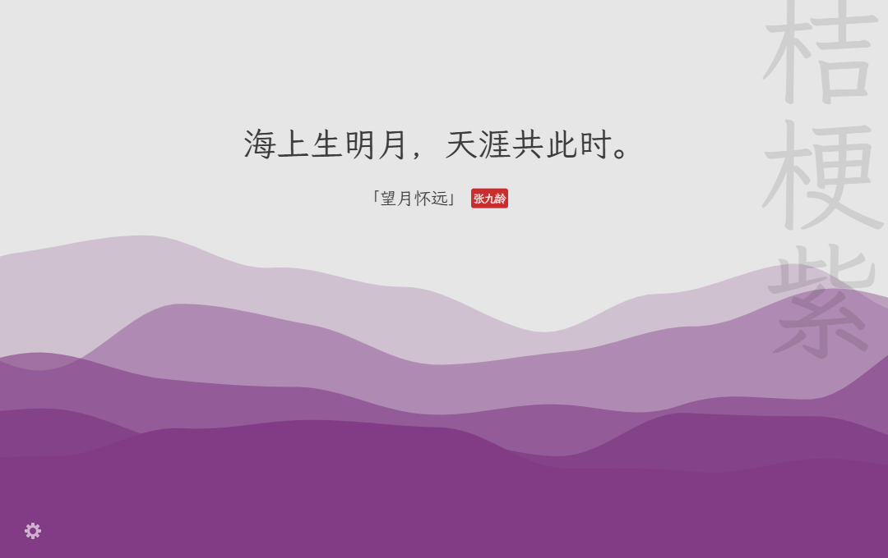
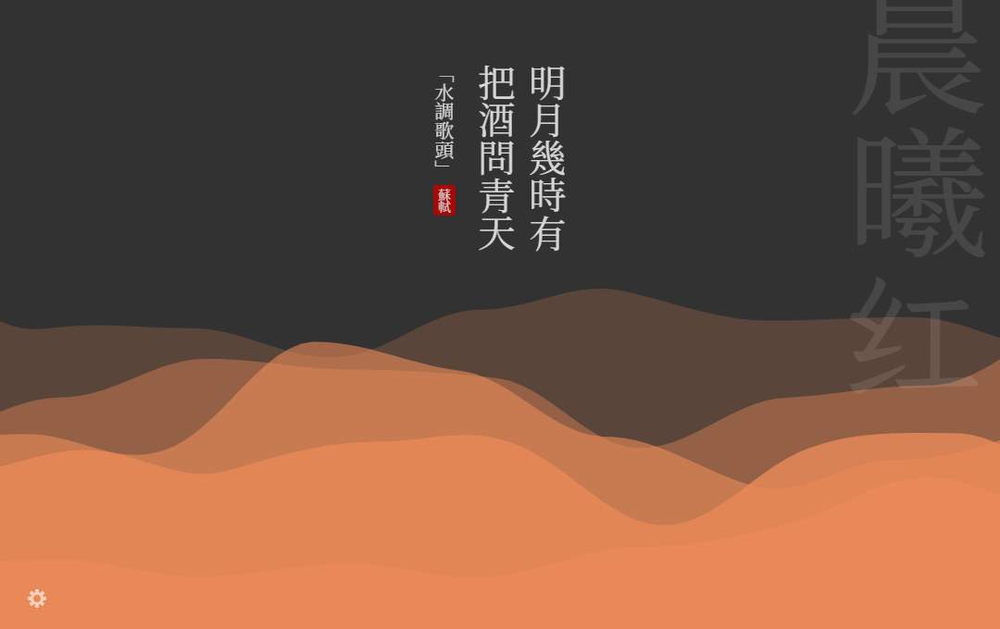
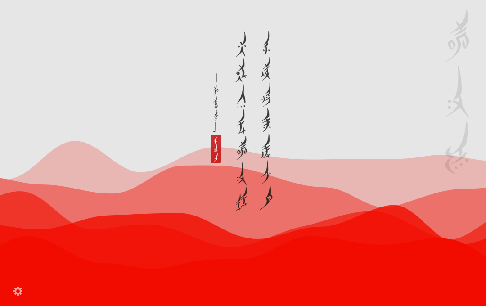
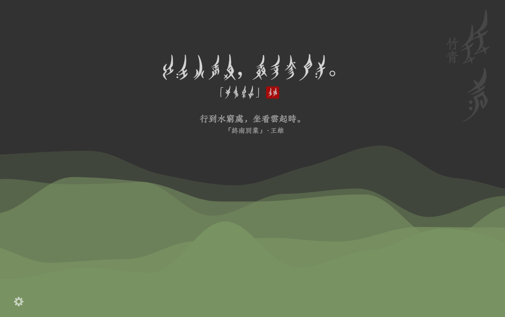
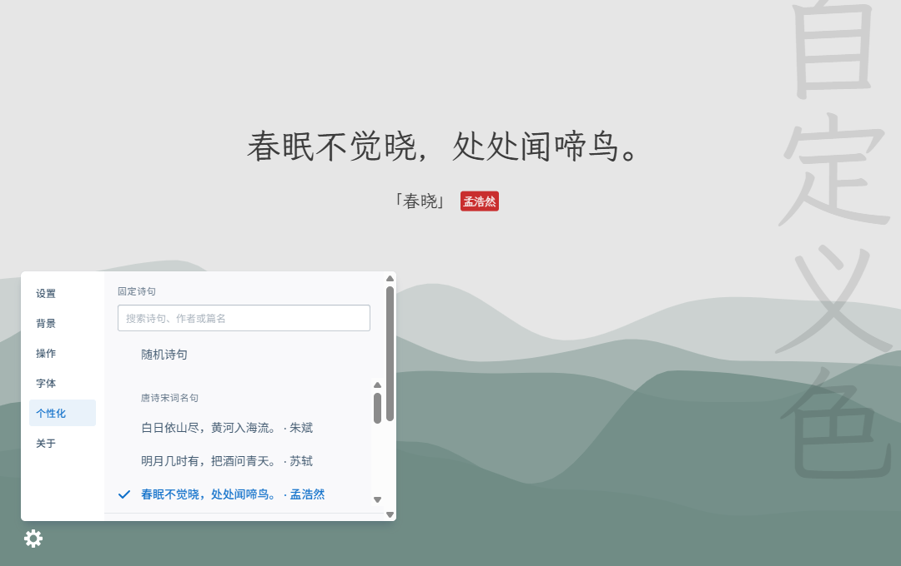
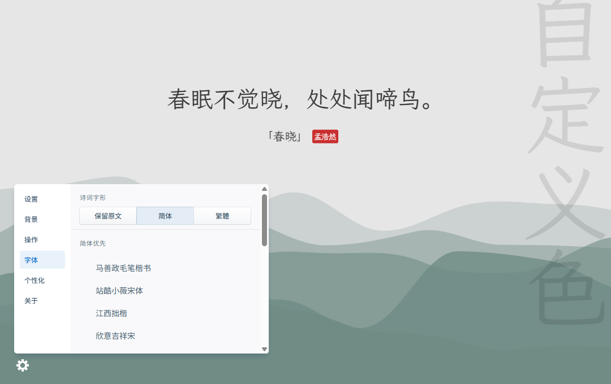

# 几枝·增强版 | Jizhi Enhanced

支持自定义新标签页的 Chrome/Firefox/Edge 扩展，几枝将在新标签页上展示中国传统色的层叠波浪动画效果搭配经典诗词。

A Chrome/Firefox/Edge new-tab extension featuring Chinese poetry and animated waves in traditional Chinese colors.

几枝·增强版是基于 Unicar 和贡献者开发的[原版几枝](https://github.com/liminalpurr/jizhi)制作的非官方版本。增强版加入了离线诗词和传统色、随机去重、固定诗句、女书凤栖，以及独立的诗词和色名设置。

## 下载与安装

[前往 GitHub Releases 查看所有版本](https://github.com/Amy22707/jizhi/releases)

当前版本：[v2.5.2](https://github.com/Amy22707/jizhi/releases/tag/v2.5.2)。支持桌面版 Chrome、Microsoft Edge 和 Firefox 142+。Chrome 和 Edge 分别提供安装包，运行文件相同。

| 浏览器 | 下载 | 本地加载方式 |
| --- | --- | --- |
| Chrome | [chrome.zip](https://github.com/Amy22707/jizhi/releases/download/v2.5.2/chrome.zip) | 解压后打开 `chrome://extensions/`，开启「开发者模式」，点击「加载已解压的扩展程序」，选择含 `manifest.json` 的目录。 |
| Edge | [edge.zip](https://github.com/Amy22707/jizhi/releases/download/v2.5.2/edge.zip) | 解压后打开 `edge://extensions/`，开启「开发人员模式」，点击「加载解压缩的扩展」，选择含 `manifest.json` 的目录。若提示扩展修改新标签页，选择「保留更改」。 |
| Firefox 142+ | [firefox.zip](https://github.com/Amy22707/jizhi/releases/download/v2.5.2/firefox.zip) | 打开 `about:debugging#/runtime/this-firefox`，点击「临时载入附加组件」，选择 ZIP，或选择解压目录中的 `manifest.json`。 |

**Firefox 当前提供未签名的 ZIP 安装包**，临时加载在浏览器重启后需要重新操作。签名后的 XPI 和扩展商店入口将在后续提供。

Chrome 和 Edge 更新本地构建后，可以在扩展卡片上点击「重新加载」。Firefox 也可在调试页面点击「重新载入」。

### 从源码构建

使用 Node.js 24 和 npm 11，在项目目录运行：

```sh
npm ci --legacy-peer-deps --ignore-scripts
npm run build:all
```

安装包和解压目录位于 `builds/`。

[隐私说明](./PRIVACY.md)

## 功能

- 打开新标签页，欣赏中国传统色的层叠波浪或 Blobs 动画。保留浅色、深色和跟随系统、动静切换、横排与竖排、色名淡出、可选搜索框和背景截图。空格暂停或播放，波浪背景下左右键换色，Alt+S 保存背景。
- 8,501 条离线诗句，精选篇目更常出现。在随机模式下，诗句避开最近 200 条，波浪色避开最近 10 个。候选不足时会缩短去重范围。历史保存在这台浏览器；固定选择会一直显示。
- 658 种传统色。**春景、山水、秋景、月夜和雪景会提高相应色系的概率，每种合适的底色仍有机会出现。**
- 齿轮 →「个性化」可选定传统色，或自定义波浪底色和名称，也可直接从推荐的唐诗宋词里固定一条，或用简体、繁体搜索诗句、作者和篇名。选回颜色里的「随机」或诗句里的「随机诗句」即可恢复轮换。

- 常用网址默认关闭。在齿轮菜单的「设置」中打开「显示常用网址」后，可在新标签页左侧固定最多 8 个网址。竖栏内置一批常用网站图标，可离线显示。其他网站默认显示站名首字。打开「联网加载网站图标」后会尝试读取本站图标。点击「添加网址」输入地址，悬停在卡片上或用键盘聚焦后，点击「···」编辑或移除。网址保存在当前浏览器。关闭后重新打开，会恢复已固定的网址。

更多原版功能见 [更新日志](./CHANGELOG.md)。

## 界面展示

### 新标签页

浅色波浪与横排诗句。可在「背景」中切换昼夜模式、波浪或 Blobs 动画。



深色波浪与竖排繁体诗词。



### 泡泡背景

在「背景」中选择 **Blobs**，让诗句浮在彩色泡泡上。


### 使用女书凤栖





### 个性化与字体

点左下角的齿轮，进入「个性化」。可从推荐的唐诗宋词中固定一条，也可搜索完整诗库，调整波浪底色。



在「字体」中选择字体、切换诗词字形，也可分别调整诗句和颜色名的字号。



## 中文字体

几枝·增强版内置 **10 款字体**，安装扩展后即可离线使用。在齿轮菜单的「字体」页可按以下分组选择。

| 分组 | 内置字体 |
| --- | --- |
| 简体优先 | 江西拙楷体、字体圈欣意吉祥宋、霞鹜臻楷、马善政毛笔楷书、站酷小薇宋体 |
| 繁體優先 | Noto Serif TC 繁體宋體 |
| 简繁皆可 | 香萃刻宋、朱雀仿宋、霞鹜文楷 |
| 女书 | 女书凤栖 · nvshu |

「诗词字形」可以独立于字体选择，提供「保留原文」「简体」和「繁體（台湾字形）」。此设置应用于诗句、篇名和作者的显示。所选字体缺少个别字形时，浏览器会使用后备字体。

选择「女书凤栖 · nvshu」会对诗句正文逐字使用凤栖字形。凤栖字库随扩展内置，选择后即可离线使用。随机模式从当前简繁设置下每个汉字都有女书字形的诗句中抽取。内置子集保留诗库用到的 1,512 个汉字对应的女书字形。固定诗句中缺少对应字形的字会以汉字显示。扩展修正了凤栖的竖排字距，横排和竖排均可使用。

诗句、作者和篇名会一起应用所选字体。「颜色名字体」位于诗词字体列表下方，默认开启「与诗词字体相同」。关闭开关后，可以直接从分组列表为右上角的色名单独选字体。诗句或色名使用女书时，可以分别打开对应的原文开关。开启诗词原文时会同时显示诗句、作者和篇名。横排时，汉字原文显示在女书下方。竖排诗句和色名的原文显示在相邻一列。两处原文共用「原文字形」和「原文字体」。原文字形默认使用繁体，可切换为简体。

想要古籍刻本的质感，可以试内置的香萃刻宋。朱雀仿宋有活字印刷的书卷气，霞鹜臻楷则适合喜欢端正楷书笔意的读者。三款均可离线使用。

## 鸣谢

原版界面、创意编程教程和作者的项目说明见[原版几枝 README](https://github.com/liminalpurr/jizhi#readme)。

**原版几枝商店入口**

[Chrome Web Store 地址](https://chrome.google.com/webstore/detail/%E5%87%A0%E6%9E%9D/hfohpokminpknagcgncibpacohagppjn) | [Firefox Add-ons 地址](https://addons.mozilla.org/en-US/firefox/addon/jizhi/) | [Edge Add-ons 地址](https://microsoftedge.microsoft.com/addons/detail/%E5%87%A0%E6%9E%9D/jpfojjhemjbonldgbbfplhnpjdfhlppe)

- 感谢原作者 Unicar、原版贡献者和开源数据、字体维护者。详见[鸣谢](./CREDITS.md)和[数据来源](./docs/data-sources.md)。
- 层叠的波浪动画效果是利用[p5.js](http://p5js.org/)实现的。
- 离线诗词来自 [chinese-poetry](https://github.com/chinese-poetry/chinese-poetry)，新增配色优先使用 [zerosoul/chinese-colors](https://github.com/zerosoul/chinese-colors)。
- 中国传统色名称及色号参考了以下来源：
  - [中国色－中国传统颜色](http://zhongguose.com/)
  - [Traditional Chinese Colors | 中国传统颜色](http://boxingp.github.io/traditional-chinese-colors/)
  - [中国传统色彩](https://color.uisdc.com/)
  - [最全！超美中国传统色 含 RGB、CMYK 色值！值得收藏！](https://www.weibo.com/ttarticle/p/show?id=2309404248238352952773)

## 原版贡献者

以下名单沿用原版几枝的贡献者记录。

<!-- ALL-CONTRIBUTORS-LIST:START - Do not remove or modify this section -->
<!-- prettier-ignore -->
<table>
  <tr>
    <td align="center"><a href="https://github.com/arthur-zheng"><br /><sub><b>Arthur Zheng</b></sub></a><br /><a href="https://github.com/unicar9/jizhi/commits?author=arthur-zheng" title="Code">💻</a> <a href="#ideas-arthur-zheng" title="Ideas, Planning, & Feedback">🤔</a> <a href="https://github.com/unicar9/jizhi/issues?q=author%3Aarthur-zheng" title="Bug reports">🐛</a> <a href="#design-arthur-zheng" title="Design">🎨</a></td>
    <td align="center"><a href="https://xnngs.cn"><br /><sub><b>xnng</b></sub></a><br /><a href="https://github.com/unicar9/jizhi/commits?author=xnng" title="Code">💻</a></td>
  </tr>
</table>

<!-- ALL-CONTRIBUTORS-LIST:END -->

This project follows the [all-contributors](https://github.com/all-contributors/all-contributors) specification. Contributions of any kind welcome!
